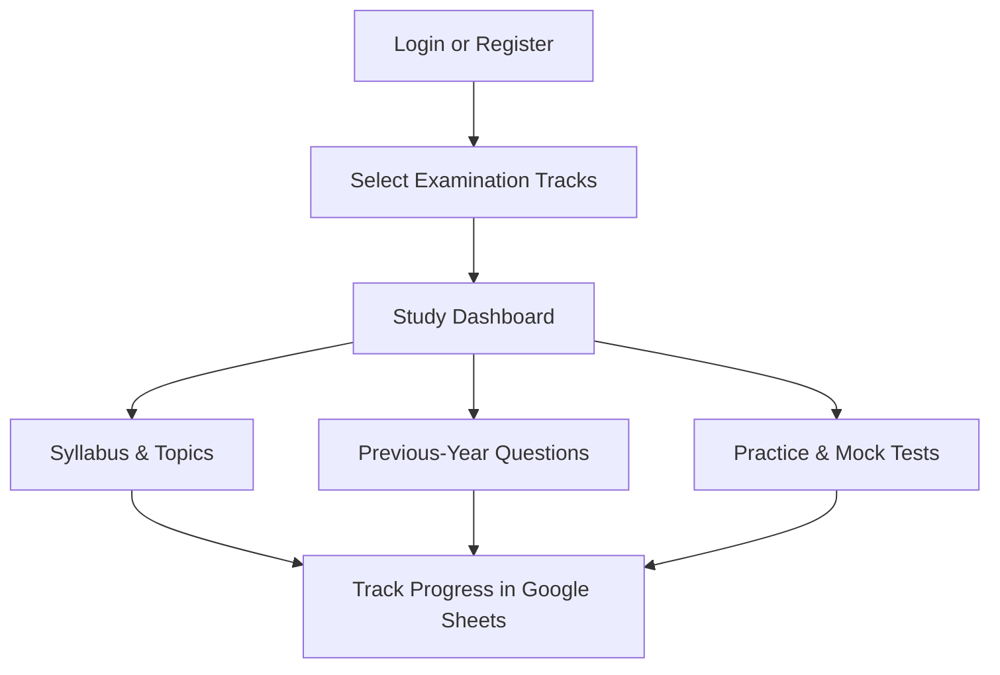

# PREPTAKE — B.Ed Examination Preparation Platform

A lightweight, modern, mobile-first web application engineered specifically for candidates preparing for competitive teacher recruitment and eligibility examinations.

Repository: [https://github.com/nadeemalam178/preptake](https://github.com/nadeemalam178/preptake)

---

## 🎯 Target Examinations

1. **CTET Paper 2: Mathematics & Science** (Classes VI–VIII, CBSE)
2. **Bihar STET Paper 1: Secondary Mathematics & Science** (Classes IX–X, BSEB)
3. **BPSC TRE 4: Classes VI–VIII Mathematics & Science** (Middle School Teacher, BPSC)
4. **BPSC TRE 4: Classes IX–X Science** (Secondary School Teacher, BPSC)

---

## 🏗️ Architecture: Google Sheets as the Only Database

PrepTake uses a completely serverless, cloud-native architecture powered by **Next.js 16 + Google Apps Script Web App + Google Sheets**. 

- **Database**: Google Sheets ([`14bH4IMp7x5nR3TJEKzt5VtIAq-WivnEPhSFCIfZwfb0`](https://docs.google.com/spreadsheets/d/14bH4IMp7x5nR3TJEKzt5VtIAq-WivnEPhSFCIfZwfb0/edit)).
- **Backend API**: Google Apps Script Web App (`doPost` and `doGet` router).
- **Security & Password Hashing**: Salted SHA-256 cryptographic password hashing. Raw passwords, hashes, and salts are never returned to the frontend.
- **Session Tokens & User Isolation**: Cryptographically generated server session tokens with 14-day expiry. User identity is derived strictly from the validated session token on the server. User A cannot access or modify User B's progress.
- **No Supabase / Firebase / Mongo**: Zero external databases or paid cloud infrastructure required.

---

## 📊 Logical Google Sheets Schema

All tables reside within the user's Google Spreadsheet:

| Tab Name | Required Columns | Purpose |
| :--- | :--- | :--- |
| **`Users`** | `UserID`, `PasswordHash`, `Salt`, `FullName`, `ActiveStatus`, `CreatedAt` | Candidate credentials with salted SHA-256 hashes. |
| **`Sessions`** | `SessionToken`, `UserID`, `ExpiresAt`, `CreatedAt` | Server-validated active sessions with 14-day TTL. |
| **`ExamSelections`** | `UserID`, `ExamID`, `SelectedAt` | Multi-examination preferences per student. |
| **`Syllabus`** | `ExamID`, `Subject`, `Chapter`, `Topic`, `Notes`, `Concepts`, `Formulas`, `Source`, `VerificationStatus` | Official syllabus items, formulas, and NCERT references. |
| **`Questions`** | `QuestionID`, `ExamID`, `Subject`, `Chapter`, `Topic`, `Year`, `Paper`, `Question`, `OptionA`, `OptionB`, `OptionC`, `OptionD`, `OptionE`, `CorrectAnswer`, `Explanation`, `SourceURL`, `QuestionType`, `VerificationStatus` | Verified official PYQs and pattern-accurate practice questions. |
| **`UserProgress`** | `UserID`, `ExamID`, `TopicID`, `CompletionStatus`, `LastStudiedAt` | Topic-level completion tracking per student. |
| **`UserAnswers`** | `UserID`, `QuestionID`, `SelectedAnswer`, `IsCorrect`, `AttemptedAt` | Question-level response history. |
| **`TestAttempts`** | `AttemptID`, `UserID`, `ExamID`, `TestID`, `Score`, `TotalMarks`, `Accuracy`, `TimeTaken`, `SubmittedAt`, `AnswersJSON` | Complete mock test drill submissions. |
| **`Bookmarks`** | `UserID`, `QuestionID`, `CreatedAt` | Questions bookmarked for revision. |
| **`Tests`** | `TestID`, `ExamID`, `Title`, `TestType`, `Duration`, `QuestionIDs`, `PublicationStatus` | Practice tests and full mock definitions. |

---

## 🧭 Application Study Flow



1. **Authentication (`/auth`)**:
   - **Login**: Enter User ID and Password. Authenticates via Google Apps Script.
   - **Create New Account**: Register with Full Name, unique User ID, and Password (min 6 characters).
2. **Select Examination (`/exams`)**:
   - Choose any combination of the 4 target examinations.
   - Selections persist to the `ExamSelections` tab in Google Sheets.
3. **Study Dashboard (`/study`)**:
   - Resume last studied topic, view preparation completion percentage, review quick stats.
4. **Syllabus & Topics (`/syllabus`)**:
   - Chapter-by-chapter concept notes, NCERT formulas, and linked official PYQs.
5. **Previous-Year Questions (`/pyqs`)**:
   - Filter by examination track, year, and topic. Instant explanations and verified source citations.
6. **Practice Tests (`/tests`)**:
   - Timed chapter drills, full PYQ tests, and mock papers. Scorecards record to `TestAttempts`.
7. **My Progress (`/progress`)**:
   - Detailed accuracy metrics, bookmarked questions, and CSV export for offline review.

---

## 🚀 Local Development Setup

### 1. Prerequisites
- **Node.js**: v18.0.0+ (v20+ recommended)
- **npm** or **pnpm**

### 2. Environment Variables
Create a `.env.local` file in the root directory:

```env
# Google Spreadsheet ID
NEXT_PUBLIC_GOOGLE_SHEET_ID=14bH4IMp7x5nR3TJEKzt5VtIAq-WivnEPhSFCIfZwfb0

# Deployed Google Apps Script Web App URL
NEXT_PUBLIC_APPS_SCRIPT_URL=https://script.google.com/macros/s/YOUR_DEPLOYMENT_ID/exec
```

### 3. Install & Run
```bash
# Install dependencies
npm install

# Start development server
npm run dev
```

Visit [http://localhost:3000](http://localhost:3000).

---

## ☁️ Deployment on Vercel

1. Push your repository to GitHub: `https://github.com/nadeemalam178/preptake`.
2. Import the repository in [Vercel](https://vercel.com).
3. Under **Environment Variables**, add:
   - `NEXT_PUBLIC_GOOGLE_SHEET_ID`: `14bH4IMp7x5nR3TJEKzt5VtIAq-WivnEPhSFCIfZwfb0`
   - `NEXT_PUBLIC_APPS_SCRIPT_URL`: Your deployed Apps Script Web App URL.
4. Click **Deploy**. Vercel will build the production bundle automatically.

---

## 🔐 Google Apps Script Updating & Deployment

Whenever you update [`google-apps-script/Code.gs`](./google-apps-script/Code.gs):
1. Open your Google Sheet → **Extensions** → **Apps Script**.
2. Paste the updated code into `Code.gs`.
3. In the top-right corner, click **Deploy** → **Manage deployments**.
4. Click the **Edit** (pencil) icon next to your active deployment.
5. Under **Version**, select **New version**.
6. Click **Deploy**. Your existing Web App URL will immediately run the updated code without changing URLs!

For complete step-by-step Apps Script setup instructions, see [`google-apps-script/README.md`](./google-apps-script/README.md).
